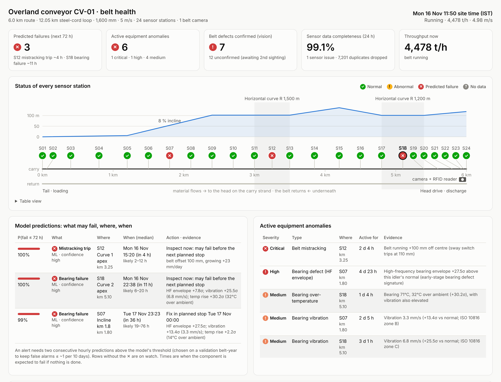
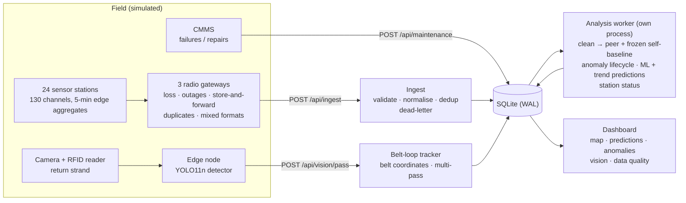
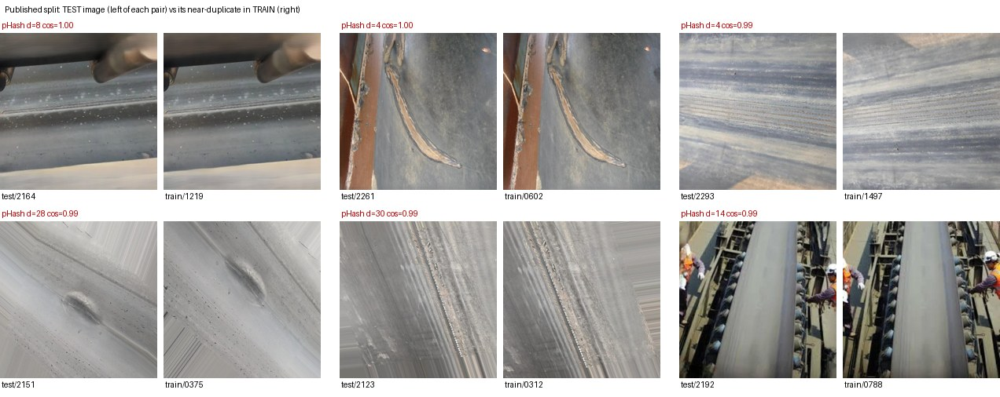
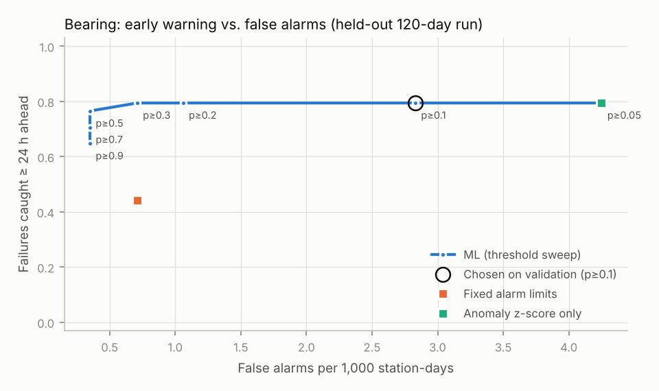
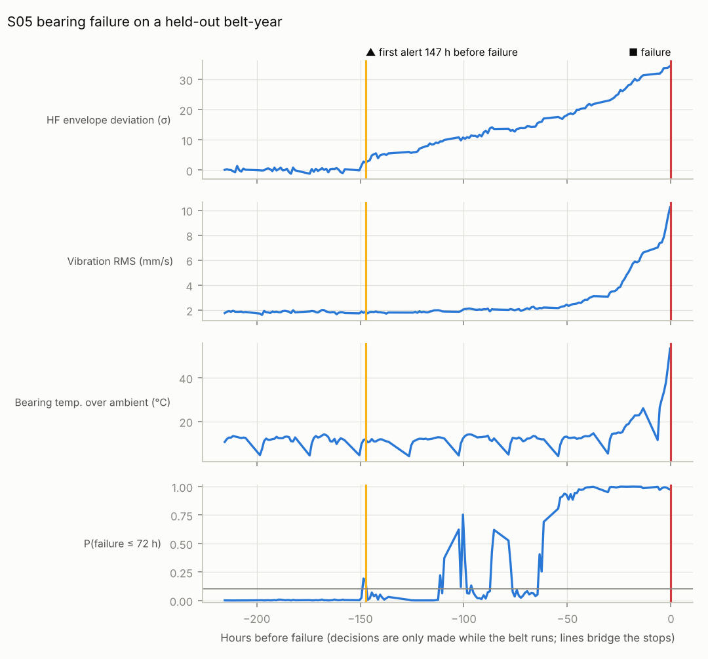
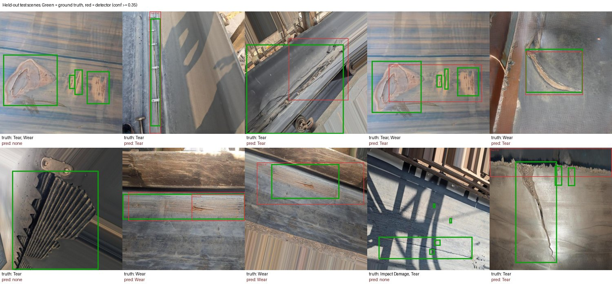
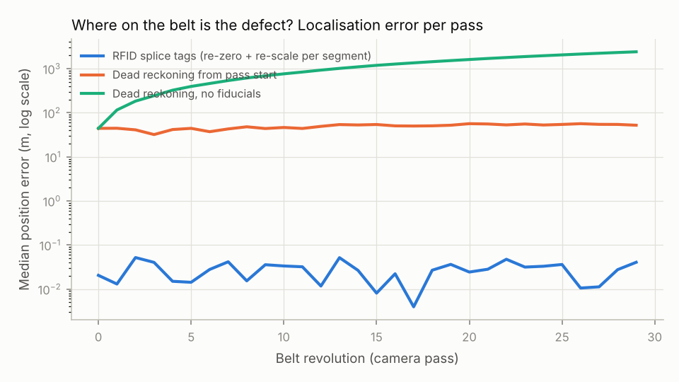
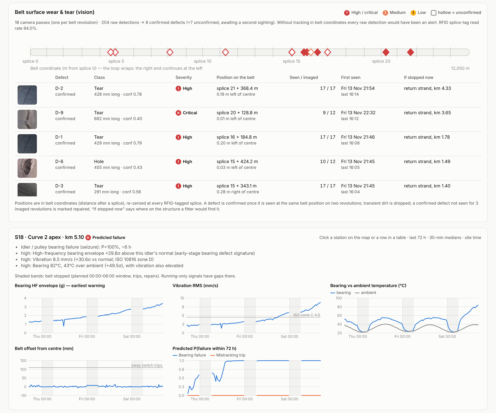
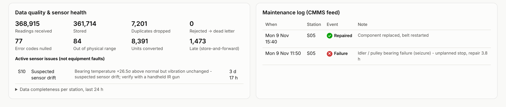

# Conveyor belt health: monitoring and failure prediction for a 6 km overland conveyor

An end-to-end system that watches a simulated multi-kilometre mining conveyor and predicts failures before they
happen. It runs from simulated sensor data to a live belt-health dashboard:

**sensor simulator → messy radio network → FastAPI/SQLite backend → data-quality layer → anomaly detection →
failure prediction (what, where, when) → camera edge node with a belt-damage detector → belt-loop defect
tracking → dashboard.**

**▶ Try it without installing anything:
[recorded replay of the live dashboard](https://vivektalwar689.github.io/conveyor-belt-monitor/demo/)**: the real
dashboard code replaying a 30-hour run of the system, with play/pause, scrubbing and drill-down. In it, a bearing
fails, a belt trips on a curve, and a camera tracks belt damage. To run the live system yourself, see
[Quick start](#quick-start).

The full design document is **[docs/DESIGN.md](docs/DESIGN.md)**. This README is the summary: the decisions, the
results, and what I would do differently.



---

## Contents
- [Quick start](#quick-start)
- [The approach in one picture](#the-approach-in-one-picture)
- [Design decisions](#design-decisions)
- [Vision dataset: source and why](#vision-dataset-source-and-why)
- [The continuous loop: what it breaks and how it is handled](#the-continuous-loop-what-it-breaks-and-how-it-is-handled)
- [Results](#results)
- [Dashboard screenshots](#dashboard-screenshots)
- [Problem breakdown: tool, model, agent, skipped](#problem-breakdown-tool-model-agent-skipped)
- [Assumptions](#assumptions)
- [What I would do differently](#what-i-would-do-differently)
- [Repository map](#repository-map)
- [How AI was used](#how-ai-was-used)

## Quick start

Python 3.11+. No hardware, no cloud account, no API keys.

```bash
make setup           # venv + core deps (simulator, backend, models, dashboard)
make setup-vision    # + ultralytics/torch for the camera edge node (CPU is fine)
make demo            # http://localhost:8000
```

Without `make` (e.g. on Windows):

```bash
python -m venv .venv && .venv/bin/pip install -r requirements.txt -r requirements-vision.txt
.venv/bin/python -m scripts.demo
```

`make demo` starts the API server and a separate analysis worker on a fresh database, and backfills 8 simulated
days through the real ingest API (~20 s). It then streams live at 120× real time (one simulated hour every 30 s), with the camera posting one pass
per belt revolution. Scripted events happen during the demo, on top of random background faults:
* **S18** (second curve) is in late-stage bearing failure and fails 9–20 simulated hours in (5–10 minutes at the
  default speed).
* **S12** (first curve) mistracks until the sway switch trips, 21–26 simulated hours in (~11–13 minutes).
* **S07** is an earlier-stage bearing failure, still predicted but not yet failed when the run ends.
* **Sensor faults:** a temperature sensor drifts (S10), a sensor sticks (S03), and a station goes offline (S20).

Scripted faults use low-noise degradation so these times hold whatever time of day you start. Without torch: `make demo-novision`.

| Command | What it does | Time |
|---|---|---|
| `make test` | 23 tests: ingestion, data quality, loop geometry, tracker, scheduling, alert rule, simulator, API | 4 s |
| `make train` | simulate 5 belt-years, build features through the production code, train, evaluate, plot | ~5 min |
| `make vision-data` | fetch the dataset at a pinned commit, audit it, re-split it | ~2 min |
| `make vision-train` | train the YOLO11n damage detector on CPU (weights are committed) | ~3 h |
| `make vision-eval` | belt-loop evaluation against ground truth, 30 revolutions | ~5 min |

## The approach in one picture



## Design decisions

1. **Monitor what fails most, costs most, and can be seen coming.** Idler and pulley bearings are the most
   common conveyor failure, and their precursors follow the P-F curve: high-frequency envelope, then vibration
   RMS, then temperature. Mistracking shows as lateral offset growing over days, mostly on curves. Drive problems
   show as load-normalised gearbox vibration, oil temperature and slip. Belt surface damage is visual. Each
   station is an edge node at a place of high stress or consequence (loading zone, inclines, curves, head). See
   the FMEA-style table in [DESIGN §2](docs/DESIGN.md#2-what-can-fail-and-what-we-monitor).
2. **Predict; do not protect.** Rip detectors, pull-wires and sway switches already trip a belt in seconds. This
   system works on hours to weeks, and nothing in it sits in a safety loop.
3. **Never silently guess with bad data.** Every reading is rejected with a reason, flagged and excluded, or
   accepted. Naive timestamps are rejected rather than assumed to be UTC. Duplicates are idempotent. A silent
   station is shown as **No data**, never as Normal. Late data is harmless because each cycle recomputes from the
   last 8 days. Details in [DESIGN §5](docs/DESIGN.md#5-messy-data-what-goes-wrong-and-what-the-system-does).
4. **Normalise twice: against peers, then against yourself.** Comparing each station with the fleet median at
   the same moment cancels weather, dust storms, load surges and start-ups. Comparing with the station's own
   **frozen** baseline cancels installation differences without letting a slow failure absorb itself into
   "normal".
5. **ML where there is a population, physics where there is not.** About 24 stations have bearings and belt
   edges, so failures anywhere teach the model about everywhere: gradient boosting. There is one drive, so its
   failures are too rare to learn from: load-normalised trend extrapolation to alarm limits, no labels needed.
6. **Evaluate like an operator.** Results are failures caught, hours of warning, whether a planned stop could be
   used, and false alarms per 1,000 station-days, on held-out belt-years. The alarm threshold is set by a
   false-alarm budget. ETA bands are calibrated with conformal prediction.
7. **On a loop, a defect is a place on the belt, not a place on the structure.** Vision detections become
   persistent tracks in belt coordinates, re-zeroed by RFID tags in the splices and confirmed by repetition.
8. **Keep LLMs out of the monitoring path.** They are non-deterministic, add latency, need connectivity a mine
   site may lack, and are hard to audit. Where one would help is described in [the breakdown](#problem-breakdown-tool-model-agent-skipped).
9. **Runs with one command.** FastAPI, SQLite and a dashboard in vanilla JS and SVG: no build step, no server to
   install. The production path (MQTT/Sparkplug, TimescaleDB, edge GPUs) is in [DESIGN §11](docs/DESIGN.md#11-production-path-what-changes-for-real).

## Vision dataset: source and why

**Source:** the curated conveyor-belt damage dataset from
[FernandoN23/Implementation-of-Object-Detection-for-Conveyor-Belt-Defect-Detection](https://github.com/FernandoN23/Implementation-of-Object-Detection-for-Conveyor-Belt-Defect-Detection)
(MIT, pinned to commit `b3e7f2e`). It has 2,312 photos of real industrial belts, 640×640, with YOLO boxes in five
classes: **Hole, Impact Damage, Puncture, Tear, Wear**. The author assembled it for an undergraduate thesis from
Roboflow Universe and academic datasets, and homogenised the classes.

**Why this one:**
* it covers **both wear and tear**, the brief's words, while most public sets are tear-only or crack-only;
* the images are real belts in real plants (undersides, idlers, galleries), not lab rigs;
* it has bounding boxes, which the loop tracker needs for position and size;
* it is reachable and has a clear licence.

**Alternatives considered:**
* **BeltCrack** (UESTC, *Pattern Recognition* 2026) would have been the better fit for the loop problem. It has
  sequential frames from real moving belts, so the same crack is seen across frames. It is hosted on ScienceDB,
  which my build environment could not reach. It is the first thing I would add.
* Roboflow projects need an API key and have unclear provenance; this dataset already aggregates several of them.
* I found no belt-damage dataset on Kaggle, only foreign-object and product-defect sets.

**What the audit found (messy input on the vision side).** The thesis notes that its sources "already contained
data augmentation", which is a red flag for train/test leakage. `vision/audit.py` measured it:

| Check | Result |
|---|---|
| Label sanity (classes, box geometry, empty files) | 0 issues |
| Exact duplicates (MD5) | 8 sets / 16 images |
| Near-duplicates surviving flips/rotations (dihedral perceptual hash ≤ 8/64 bits) | 11,793 pairs |
| Same-scene frames (CNN-embedding cosine ≥ 0.97, threshold set by inspecting pairs per band) | 32,749 pairs |
| **Published valid / test images with a same-scene twin in train** | **98.5 % / 99.1 %** |
| A "classifier" that just returns the nearest training photo's label | **96.1 %** on the published split vs **76.4 %** on a clean split |
| Healthy (defect-free) images | only 39 of 2,312 |

The published split mostly measures memorisation, so the thesis's mAP@0.5 ≈ 0.90 is optimistic. I merged
duplicates into **138 scene groups** and re-split 70/15/15 **by group**, so no scene straddles two splits, with
multi-label stratification so every class is in every split.



## The continuous loop: what it breaks and how it is handled

The belt is a 12,050 m loop that passes the camera once every ~40 minutes. That creates these problems:

| # | Consequence | How the system handles it | |
|---|---|---|---|
| 1 | The same defect comes back every revolution: **~27 duplicate alerts per defect per day** with per-frame alerting | Detections associate to persistent **defect tracks**; one defect is one alert | ✅ |
| 2 | "Where" means *where on the belt*; the structure only tells you where the belt is now | Positions are stored in **belt coordinates** (splice number + metres) | ✅ |
| 3 | Odometry drifts: 0.4 % encoder error is ~48 m per revolution, unbounded over time | **RFID tag in each splice**: each read re-zeroes position and re-scales the odometer per segment (absorbs stretch, slip, missed reads) | ✅ measured |
| 4 | Coordinates wrap: 12,049 m and 1 m are 2 m apart | Circular distance and mean everywhere | ✅ tested |
| 5 | Dirt, water and carry-back look like damage once | **Confirm** only after sightings on ≥ 2 revolutions at the same position; unconfirmed tracks missed twice are dropped | ✅ measured |
| 6 | "Not seen" means nothing if that stretch was not imaged (fouled lens, skipped frames) | Misses count only inside each pass's **coverage**; a confirmed defect imaged 3 times without a detection is marked repaired | ✅ tested |
| 7 | Sightings form a time series | Growth rate per defect escalates severity (a growing tear outranks a big stable patch) | ⚠️ built, but the dataset cannot show real growth |
| 8 | The per-frame false-positive rate is multiplied by ~12,000 frames per revolution | Measured; detector chosen and confidence floor set by defects-vs-phantoms over many revolutions, not by mAP (see Results) | ⚠️ analysed, not solved |
| 9 | When the belt stops, a fitter needs a place on the 6 km structure | "If stopped now": strand + chainage for every defect | ✅ |
| 10 | The loop yields 12 km of fresh imagery every 40 min | Should become hard negatives and self-supervision (defects persist, dirt does not) | ❌ next step |
| 11 | Re-splicing renumbers the belt | Belt register update and track migration | ❌ not handled |
| 12 | Carry vs pulley side, turnover, motion blur, lighting | Camera on the return strand after the cleaners; blur and lighting simulated per pass | ⚠️ partly |

Because each defect returns every ~40 min, the per-frame detector can be tuned for **precision**. **Recall**
comes back through repetition: a defect missed on one revolution is seen on the next.

## Results

### Sensor-based prediction (held-out belt-years, `make train`)

Two independent 120-day test belt-years, 24 stations. "Harsh" has ~5× the outages, stuck/drifting sensors, spikes
and error codes. Bearing failures include 20 % *fast* failures with only ~1 day of warning, as real fleets do.

**Bearing failures** (35 in the normal year, 33 in the harsh year):

| Method | Caught ≥ 24 h ahead | Median warning | Fixable in a planned stop | False alarms / 1,000 station-days |
|---|---|---|---|---|
| Fixed alarm limits (ISO zone C vibration, temperature) | 44 % · harsh 21 % | 23 h · 15 h | 62 % · 42 % | 0.7 · 3.2 |
| Anomaly z-score alone | 79 % · 91 % | 107 h · 105 h | 94 % · 97 % | 4.2 · **13.5** |
| **ML (gradient boosting)** | **79 % · 91 %** | **78 h · 73 h** | **97 % · 97 %** | **2.8 · 1.1** |

**Mistracking trips** (17 / 14): ML catches 100 % at least 24 h ahead (median 75 h / 83 h) with zero false alarms.
Fixed 75 mm limits catch 53 % / 57 % a day ahead.

**Drive** (trend-to-threshold, no ML): all 3 gearbox failures were predicted 97–137 h ahead and all 3 slip trips
36–39 h ahead. There were 3 and 1 false alarms over 240 days. With n = 3 these are anecdotes, not statistics.

**When ("ETA") bands.** The raw P10–P90 bands from the quantile models covered only **53 %** of actual failure
times on alerted rows, against 80 % nominal. After **conformal calibration** on the validation belt-year, test
coverage is **82 %** for bearings and 92–95 % for mistracking. Median ETA error is 11–13 h for bearings and 5–6 h
for mistracking.

What this means:
* **Fixed limits are trustworthy but late.** They fire when vibration is already in zone C, so fewer than half the
  failures can wait for a planned stop.
* **The z-score sees trouble earliest but cries wolf** when data quality degrades (13.5 false alarms per 1,000
  station-days in the harsh year, about one every 3 days on this belt).
* **The model**, trained on data that was damaged and repaired like production data, keeps the early warning and
  holds false alarms near 1–3. It turns about 95 % of bearing repair hours from unplanned into planned (95 of
  101 h, and 95 of 97 h in the harsh year). Fixed limits manage 58 % and 42 %.

**Caveat:** these models are trained and scored on my own simulator. The absolute numbers say more about the
simulator than about a real conveyor. The comparison between methods, the failure modes of each, and the
pipeline are the transferable part.

| | |
|---|---|
|  |  |

### Vision (leakage-free test split, `make vision-eval`)

**Two detectors, one honest metric.** Both are YOLO11n (COCO-pretrained, 512 px, trained on CPU) evaluated on held-out
scenes:
* the **baseline**, trained on the leakage-free split;
* a version **fine-tuned with 1,199 mined hard negatives**: defect-free crops cut from training images, because the
  dataset has only 39 healthy images.

The thesis behind the dataset reports mAP@0.5 = 0.90 on its leaky published split.

| | Baseline | **+ hard negatives (deployed)** |
|---|---|---|
| Box mAP@0.5, held-out test scenes | 0.12 | 0.06 |
| Damaged frames detected (confidence ≥ 0.35) | 72 % | 45 % |
| **Healthy frames with a false detection** (≥ 0.35) | 30 % | **8 %** |
| **Belt defects confirmed / phantom defects confirmed** (floor 0.35, 30 revolutions) | 9 of 11 / 8 | **8 of 11 / 0** |
| Same at floor 0.25 | 11 of 11 / 16 | 9 of 11 / 2 |

Box mAP got *worse* and the system got *better*. mAP rewards box overlap and the right class on single photos. The
loop needs "is there damage at this belt position, revolution after revolution", and the fine-tuned model finds
about as many real defects with almost no phantoms. I chose the deployed model by the system-level metric, and the
tracker runs at a 0.35 confidence floor. Wear and tear have fuzzy extents, so IoU-based mAP understates what a belt
camera needs. The examples below (baseline model) show detections that land on the damaged region with a
different box or class, and misses. **The detector is the weakest component**, and the evaluation is designed to
show that rather than hide it.



**Belt-loop handling.** 30 simulated revolutions; the real detector runs on held-out images re-rendered each
revolution with different light, blur, noise and lateral wander; transient dirt is added and coverage gaps appear:

| | **RFID splice tags (design)** | Dead reckoning per pass | No fiducials |
|---|---|---|---|
| Median position error | **0.03 m** (p95 0.08 m) | 55 m | 1.2 km, reaching 2.4 km by revolution 30 |
| Real defects confirmed (baseline detector, floor 0.25) | **11 / 11** | 1 / 11 | 0 / 11 |

* Dedup: every raw detection would otherwise be an alert. That is 514 over 30 revolutions with the deployed model
  (47 per real defect) and 1,588 with the baseline; the tracker raises one alert per defect.
* Transients: dirt and one-off false positives become unconfirmed tracks and are dropped (105 with the deployed
  model).
* Repairs: in the baseline run, the defect repaired mid-run was retired after 3 imaged revolutions. Defects in
  stretches a fouled lens skipped were not penalised.



**The most important finding: the loop multiplies false positives.** The simulation images ~40 healthy frames per
revolution; a real camera images all ~12,050. Even the deployed model's 8 % healthy-frame false-positive rate means
~960 false detections per revolution at full coverage, enough for random coincidences across revolutions to
confirm phantom defects. **Multi-pass confirmation in belt coordinates is necessary but not sufficient.** The
hard-negative experiment shows the way: generic crops alone cut false positives 3–4×. Defect-free footage of
*this* belt should go much further, and the loop supplies it for free (see
[What I would do differently](#what-i-would-do-differently)).

## Dashboard screenshots

The dashboard covers the brief's four minimum requirements plus two additions:

1. **Status of every sensor point:** the belt map at true chainage, with a table view.
2. **Active anomalies:** location, type and severity.
3. **Predictions:** what, where and when, with a calibrated range and a recommended action tied to the planned-stop
   schedule.
4. **Vision detections:** the belt-loop strip in belt coordinates, with crops.
5. **Station drill-down:** detail charts for any station.
6. **Data quality:** ingestion and sensor-health panel.





One illustration from the run in these screenshots (an anecdote, not evidence; the statistics are under
[Results](#results)). At the moment of capture the model gave S12's mistracking trip a median of ~4 h (likely 2–12 h)
and said "inspect now". The belt tripped 3.5 h later, and the maintenance log then shows the repair and restart.

## Problem breakdown: tool, model, agent, skipped

| Concern | Built as | Why |
|---|---|---|
| Ingestion, units, timestamps, dedup, dead-letter | Deterministic code | Must be exact, auditable, testable |
| Spikes, stuck sensors, offline stations, sensor drift | Deterministic rules | Explainable; operators can verify them |
| "Is this unusual?" | Statistics (peer + frozen self-baseline, robust z) | Needs no failure labels |
| Bearing and mistracking prediction | Learned model + conformal ETA bands | A population of similar assets produces enough failures |
| Drive gearbox and slip | Physics-informed trend extrapolation | One asset: never enough failures to learn |
| Damage in images | Learned detector (YOLO11n) | The only practical way |
| Loop localisation, association, confirmation | Deterministic geometry | It is a geometry problem; a learned version would be worse and opaque |
| Action recommendation | Rules over predictions + duty schedule | Must be predictable |
| **LLM agent** | **Not built, on purpose** | It belongs *on top of* these tools, not inside them: a shift-handover summary or a draft work order calling the same `/api/*` endpoints, with a human approving |
| **Skipped** | Fire detection, splice scanning, cover thickness, acoustic arrays, drones, take-up forecast, auth, multi-conveyor | Separate products or scope; listed in [DESIGN §2](docs/DESIGN.md#2-what-can-fail-and-what-we-monitor) |

## Assumptions

The brief left these open, so I chose and documented them; details in [DESIGN §1](docs/DESIGN.md#1-context-and-assumptions).

* **The belt:** one 6.0 km overland belt, steel cord, 1,600 mm, 5 m/s, 6,000 t/h, so the loop is 12,050 m and one
  revolution takes about 40 min. Head drive (3 × 1 MW), gravity take-up, loading at the tail.
* **Duty and climate:** runs 06:00–24:00 IST with a **planned stop 00:00–06:00** used for maintenance. The site is
  hot and dusty, and dust storms degrade the radio links.
* **Sensors:** 24 sensor stations, each an edge node sending 5-minute feature aggregates rather than waveforms.
* **Vision hardware:** one camera on the return strand after the belt cleaners, an RFID reader beside it, and an
  RFID tag in each of the 25 splices.
* **Simulated timescales:** degradation is compressed (bearing P-F interval median ~6 running days, 20 % fast
  failures of ~1 day) so that failures happen within a simulation.
* **Labels:** failure labels come from a maintenance log (the CMMS stand-in) that the simulator also produces.

## What I would do differently

* **Get real data before more modelling.** The biggest risk is the simulator: a model trained on it inherits my
  assumptions. With access to a site I would first pull 6–12 months of historian data and CMMS work orders,
  check which failure codes are actually recorded, and only then decide what to predict. Labels are a process
  problem (failure coding in work orders), not a code problem.
* **Use the loop as a data engine.** Every revolution gives 12 km of new belt images. Defects persist across
  revolutions and dirt does not, which is a free self-supervision signal: auto-label hard negatives and
  high-confidence positives, and send the uncertain ones to a human. This attacks the detector's main weakness,
  which is that it has seen almost no healthy belt (39 images). Generic hard negatives already cut false positives
  3–4× in the experiment above; site footage is the real fix.
* **Add BeltCrack** (sequential frames from moving belts) for training and to test association on real
  sequences. Add a *splice* class so splices become both a fiducial and a monitored component.
* **Treat alarms as a product.** Add ISA-18.2-style alarm management (shelving, flood suppression, priorities) and
  "confirm / false alarm" buttons that become training labels.
* **Calibrate per site.** Thresholds, conformal widths and baseline windows were tuned on simulated belt-years.
  A real deployment should re-fit them per conveyor in shadow mode before anyone acts on an alert.
* **Smaller things:** a TimescaleDB backend; streaming feature updates instead of an 8-day recompute; a take-up
  travel forecast; an LLM shift-handover summary built on the existing API, with citations to the data it used.

## Repository map

```
simulator/   config.py (belt, stations, channels) · engine.py (physics, failures) · faults.py (messy data)
             generate.py (offline belt-years → Parquet) · stream.py (live HTTP stream + camera thread)
backend/     app.py (FastAPI) · worker.py (analysis process) · db.py (schema) · ingest.py · quality.py
             features.py · anomaly.py · predict.py (ML + trend + schedule) · analysis.py · vision_service.py
ml/          dataset.py (features + labels) · train.py · evaluate.py (event-level, figures)
vision/      fetch_dataset.py · audit.py (leakage audit, re-split) · train_detector.py · edge_sim.py
             loop.py (belt register, localiser, tracker) · loop_eval.py · demo_images/ (MIT subset)
dashboard/   index.html · app.js · styles.css (vanilla JS + SVG; also runs as a static replay)
scripts/     demo.py · record_replay.py (→ docs/demo/, GitHub Pages) · screenshots.js
models/      sensor_models.joblib · belt_damage_yolo11n.pt
docs/        DESIGN.md · images/
tests/       pytest suite
ai_usage/    AI chat logs (see below)
```

## How AI was used

This repository was built with **Claude Code** (an agentic coding assistant). The session transcript is in
[`ai_usage/`](ai_usage/). The transcript shows the problem breakdown and the design choices. It also shows the
places where a first version was wrong and was caught by an explicit check rather than by luck:

* **Duplicate-image thresholds.** The first thresholds merged 2,224 of 2,312 images into one "duplicate" group.
  Caught by looking at image pairs in each similarity band before choosing thresholds.
* **Simulator too easy.** The first simulator gave 100 % recall for every method, which made the comparison
  meaningless. Fixed by adding fast failures and varied signature strength.
* **Baseline absorbing failures.** The rolling baseline absorbed slow failures, so z-scores collapsed just before
  failure. Caught by plotting one failure end to end; replaced with a frozen, sequential baseline.
* **Overconfident ETA bands.** They covered 53 % instead of 80 %. Fixed with conformal calibration. The first
  coverage check was itself biased (it selected on the outcome) and was corrected to score alerted rows only.
* **Drive false alarms.** The drive trend method raised 12 false alarms per belt-year because it ignored load
  and ambient. Fixed by load-normalising and requiring a significant slope.
* **Live alerts stricter on paper than in practice.** A healthy station showed "predicted failure" in the live
  demo after one 5-minute reading crossed the (deliberately low) threshold, while the evaluated false-alarm rate
  assumed 2 consecutive hourly decisions. Fixed by applying the evaluated rule in the backend, with tests.
* **Vision ground truth.** The first loop evaluation compared track positions with a lateral value that was never
  used when rendering images, inflating "false" tracks. Fixed by scoring against each image's labelled boxes.
* **Choosing the detector by the wrong metric.** By box mAP the hard-negative fine-tune looked like a failure
  (0.12 → 0.06). The belt-loop evaluation showed it was the better system component (0 phantom defects instead
  of 8 at the same floor), so the deployed model was chosen on the system-level metric.
* **Slow training run.** A training run took 10× too long because OpenMP and PyTorch were oversubscribing 4
  cores. Found with `py-spy` and fixed with `OMP_NUM_THREADS=1`.

<!-- Candidate: add your own notes here - what you reviewed, questioned or overrode, and what you would have decided differently. -->
